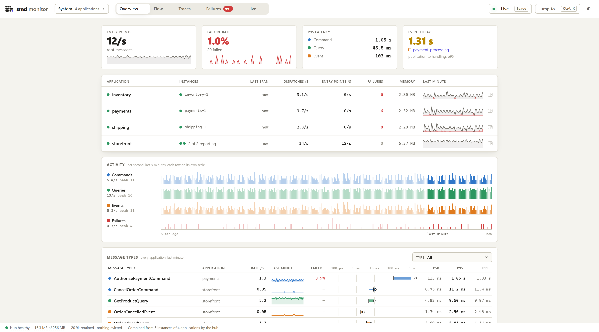
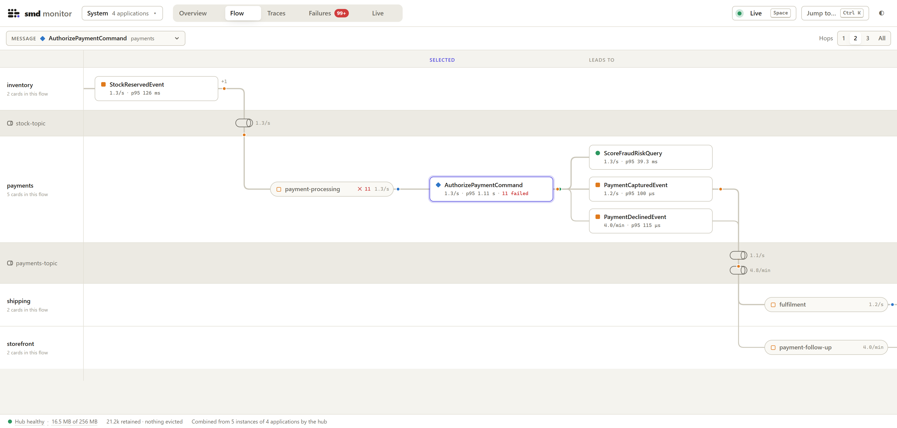
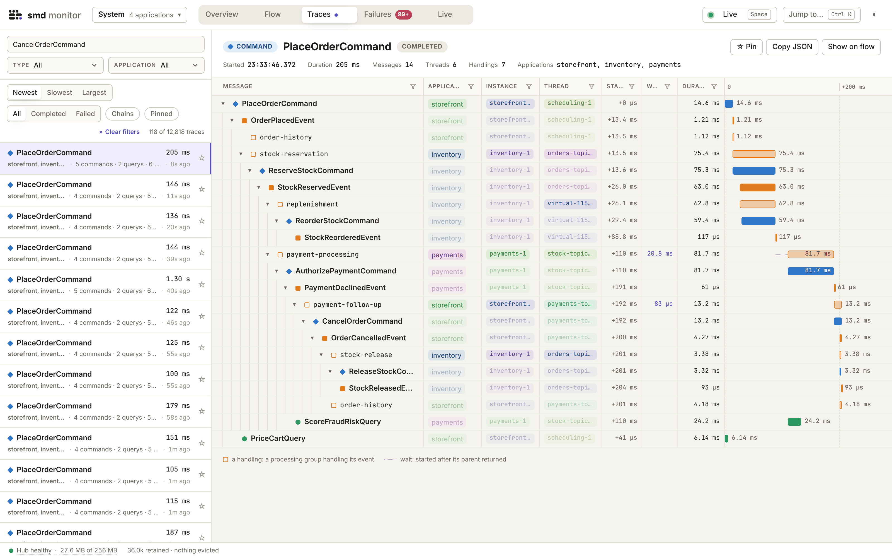
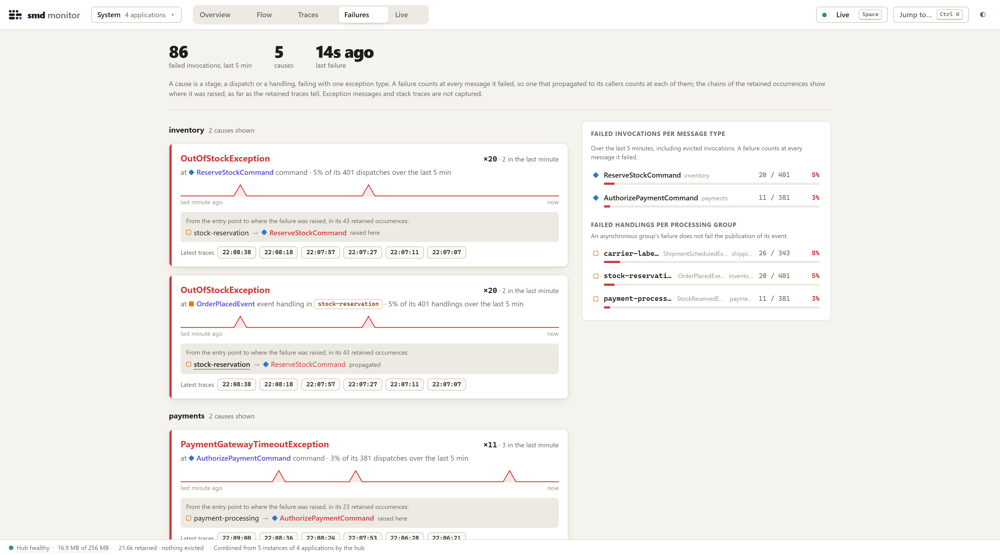
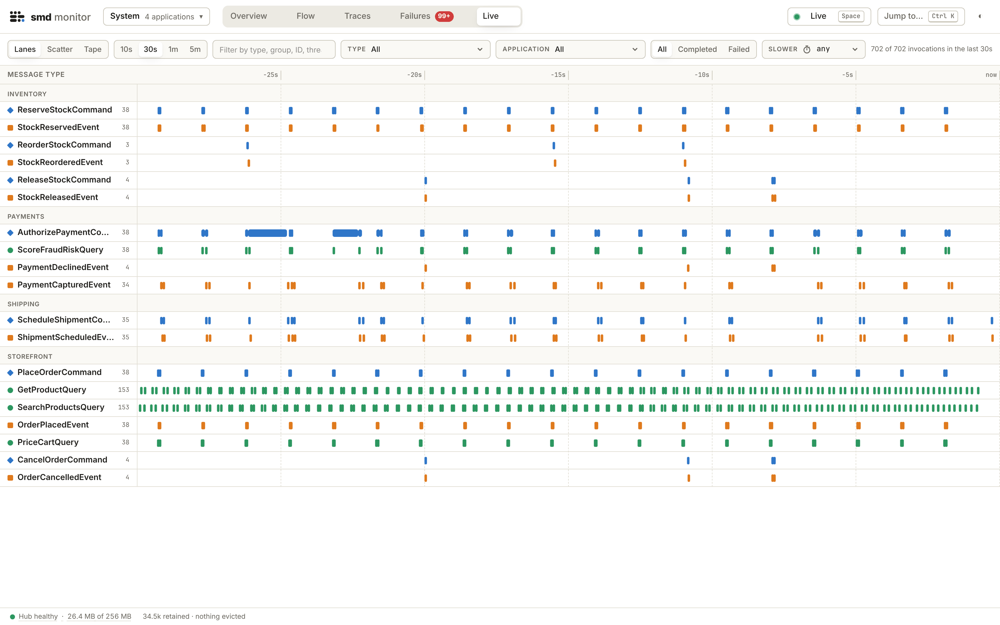

# SMD Monitor

> **EXPERIMENTAL**: SMD Monitor is in early development and may introduce breaking changes while it remains in the `0.0.x` line.

A live monitor for applications built with [Simple Message Dispatch](https://github.com/DavidOpDeBeeck/simple-message-dispatch) (SMD). It shows what causes what, where
time goes, and what fails, across every application that sends it its commands, queries, and events.

Applications record their messages as OpenTelemetry spans with SMD's `smd-opentelemetry` and export them to the **hub**, a standalone Spring Boot application. The hub
counts, links, and retains them in memory and serves the monitor page. The monitor is optional: SMD does not depend on it, and the same spans can go to any
OpenTelemetry backend.

<picture>
  <source media="(prefers-color-scheme: dark)" srcset="docs/screenshots/overview-dark.png">
  
</picture>

## Try it

```shell
./gradlew demo
```

Open <http://127.0.0.1:8080/>. The demo runs a hub and a web shop of four applications that export to it, in one JVM, with no database or Collector:
storefront takes orders on two instances, and inventory, payments, and shipping each read the previous application's events from an in-memory topic.

## A look around

**Flow** follows a message across applications and the topics between them: what caused it, what it led to, and how each step fares.

<picture>
  <source media="(prefers-color-scheme: dark)" srcset="docs/screenshots/flow-dark.png">
  
</picture>

**Traces** lays out a retained trace as a waterfall, with the application, instance, and thread of every message and handling: here a declined payment,
which storefront compensates by cancelling the order and inventory by releasing its stock.

<picture>
  <source media="(prefers-color-scheme: dark)" srcset="docs/screenshots/traces-dark.png">
  
</picture>

**Failures** groups failures by cause and shows the chain from the entry point to where each was raised.

<picture>
  <source media="(prefers-color-scheme: dark)" srcset="docs/screenshots/failures-dark.png">
  
</picture>

**Live** shows every invocation of the last seconds or minutes as it happens.

<picture>
  <source media="(prefers-color-scheme: dark)" srcset="docs/screenshots/live-dark.png">
  
</picture>

## Run the hub

```shell
./gradlew bootJar
java -jar build/libs/smd-monitor-hub-0.0.1.jar
```

The hub serves the page at <http://127.0.0.1:8080/> and receives spans at <http://127.0.0.1:4318/v1/traces>, on a port of its own. It has no
authentication: put a reverse proxy that authenticates in front of the page, and keep the OTLP port private. The `Dockerfile` runs it in a container.

Then add `spring-boot-starter-opentelemetry` to each application, sample every span, and point its OTLP exporter at the hub. See
[Set up the monitor](docs/monitor.md#set-up-the-monitor).

The monitor needs SMD 0.0.12 or newer.

## Documentation

- [Live monitor](docs/monitor.md): setup, configuration, security, and what the page shows
- [Hub design](docs/monitor-hub-design.md): the hub's design decisions, budgets, and benchmarks, for contributors
- [Brand](docs/brand.md): the SMD mark and its colors

## Build

Building needs Java 25 and Node.js 22.12 or newer on the `PATH`. The build uses the published SMD artifacts of the version in `gradle/libs.versions.toml`.

```shell
./gradlew check
```

## License

[MIT](LICENSE)
